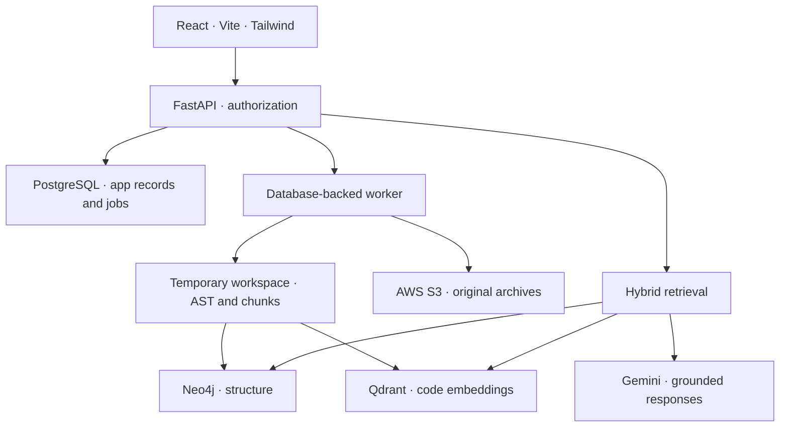

# CodeOS AI architecture

## Service boundaries

The browser sends application operations to FastAPI. Google's Identity Services script additionally communicates with Google for sign-in; the browser never receives datastore credentials. PostgreSQL stores users, repositories, conversations, messages, activities, reviews, engineering memories, documentation, settings, manifests and job state. JSON columns hold structured application metadata such as review reports and file manifests; PostgreSQL does not mirror the graph or vector index.

S3 stores one stable archive object key per repository: `repositories/{user_id}/{repo_id}/source.zip`. The metadata record retains its SHA-256 and, for GitHub imports, the source commit. AWS encryption defaults to SSE-S3. MinIO is an explicit local-development substitute for S3, with separate persistent object-store volumes.

Neo4j contains `CodeNode` records and repository-scoped `CODE_REL` relationships whose `kind` represents CONTAINS, IMPORTS, CALLS or EXTENDS. Relationships carry stable source/target IDs. Nodes have a uniqueness constraint on their stable IDs and indexes for repository and qualified-name lookups. User/application records are absent from Neo4j.

Qdrant holds code text, source metadata and dense embeddings. Named vectors carry a fingerprint of the embedding model, dimensions, cosine metric and index format. Initialization rejects mismatched collections, including a same-dimension collection created for a different model. The backend never silently substitutes lexical or fake embeddings in production.

## Ingestion lifecycle

1. Authenticate and check repository quota. Validate GitHub URL/branch or ZIP type, size and directory entries.
2. Reserve a PostgreSQL repository record with a stable archive key before writing external storage. Interrupted uploads remain visible and deletable.
3. ZIP input is streamed to an isolated temporary file, checked and stored unchanged in S3. A GitHub worker shallow-clones the selected branch, creates a ZIP without `.git` or symlinks, and stores it in S3.
4. Use the same archive-processing path for ZIPs, GitHub snapshots and retries. Verify SHA-256, reject traversal, links, encryption, duplicate paths, excessive expansion and file-count limits, then extract into a temporary workspace.
5. Normalize a single wrapper directory. Inventory supported files, parse ASTs, resolve structural relationships, and build overlapping bounded chunks across all included source lines. Common credential files, generated directories, oversized files and minified lines are excluded from indexing and preview.
6. Set the repository unavailable for questions while indexing. Clear the repository's prior graph/vector namespace and write stable IDs in bounded batches.
7. Verify actual graph-node, graph-edge and vector counts before marking the repository ready. Persist file metadata and language counts.
8. Remove temporary clone, archive and extraction paths on success, failure, timeout or cancellation. Source-code file previews subsequently read the original S3 archive inside their own temporary context.

Re-ingestion reprocesses the stored snapshot; it does not silently fetch a newer GitHub commit. Import again to analyze a newer version. If there is no saved archive because the initial GitHub import failed, retrying may retry that initial clone.

## Durable work and cleanup

The API inserts jobs into PostgreSQL and returns HTTP 202. One worker runs inside FastAPI by default. Set `WORKER_ENABLED=false` and run `python worker.py` for a separate worker process. Each process handles one expensive job at a time. Additional workers can claim independent jobs using `FOR UPDATE SKIP LOCKED`.

A PostgreSQL advisory lock stays held across a repository's external writes. Heartbeats renew job leases; an expired lease alone cannot admit a second worker while the first still holds that lock. Upload requests use the same repository lock to coordinate archive writes with cleanup. A graceful shutdown requeues an unfinished job; a lost worker's expired job can be reclaimed. There is no distributed transaction across the stores.

Deletion marks the repository deleting, cancels pending work, requests cancellation of running work, and queues a cleanup job. Cleanup removes Neo4j data, Qdrant payloads/vectors and all versions of the exact S3 archive key. Each completed stage is recorded so a failed stage can retry. PostgreSQL is deleted last; foreign keys cascade conversations/messages, jobs, reviews, documentation, memories and repository activity. A store failure produces retry/deletion-failed state rather than falsely reporting immediate completion.

Failed ingestion attempts remove partial indexes. When that cleanup cannot finish, a separate persisted cleanup job retries it; the original archive remains available for a future ingestion retry. After the configured retry limit, the failed job remains inspectable and the user can retry re-ingestion or deletion.

## Hybrid retrieval

A question is authorized against the selected ready repository. Gemini embeds it as a retrieval query. Qdrant searches that repository's matching embedding namespace. Candidates are deduplicated, ranked with a small identifier/path relevance boost and diversified across files.

The backend expands related symbols through bounded Neo4j neighborhoods and assembles code snippets, honest line ranges, symbol locations and explicit relationships. Context size is bounded. Gemini is instructed to use this evidence, cite paths/lines, distinguish static inference from runtime facts and treat repository content as untrusted data. No retrieved code is executed. Source excerpts and relationships persist on the assistant message and reopen the matching file in the UI.

Empty evidence produces an insufficient-evidence response. Provider failures return an error response and do not become fabricated successful assistant messages. A model can still make mistakes; source evidence supports review, not a guarantee of correctness.

## Scope and practical limits

- Python has dedicated AST extraction. JS/JSX/TS/TSX and several other languages use tree-sitter structural extraction. Text, Markdown, JSON, YAML, TOML, CSS, HTML, SQL and shell files can supply file-level evidence. Symbol extraction is best on Python and JavaScript/TypeScript and does not implement complete compiler-level semantics for every language.
- Calls, imports and inheritance are static best-effort relationships. Ambiguous receivers and dynamic dispatch are not presented as certain call edges. No runtime instrumentation is claimed.
- Architecture analytics load a bounded graph snapshot (5,000 nodes and 20,000 edges). The graph UI initially displays 120 nodes; graph/file/job/repository APIs expose bounded pagination. These views do not imply a full compiler or unlimited graph analysis.
- GitHub imports are shallow snapshots. Available timeline metadata is saved before deleting the clone; complete Git history is not retained. ZIPs normally have no Git history.
- One repository has one stored snapshot; indexing blocks its chat until ready. Parallel historical-version querying and zero-downtime index swaps are outside this checkpoint.
- Process-local caches are optional conveniences, not application storage. PostgreSQL, Neo4j, Qdrant and S3 own persistent state.

## References used for integration checks

- Gemini embeddings: https://ai.google.dev/gemini-api/docs/embeddings
- Gemini model availability/deprecation: https://ai.google.dev/gemini-api/docs/deprecations
- Qdrant collections: https://qdrant.tech/documentation/manage-data/collections/
- Qdrant query API: https://api.qdrant.tech/api-reference/search/query-points/
- Qdrant Python client: https://github.com/qdrant/qdrant-client

## Identity and documentation

Google credentials are validated server-side and matched to a unique permanent subject. A ten-minute browser nonce binds sign-in to its originating browser. Linking to an existing password account requires that password. The schema change is an additive Alembic migration.

Documentation drafts are generated from bounded repository evidence and saved in PostgreSQL, with repository-row locking during the final save to coordinate concurrent drafts and deletion. The workspace supports ten types, regeneration, Markdown download and ZIP export. AI drafts should be reviewed before publishing.
